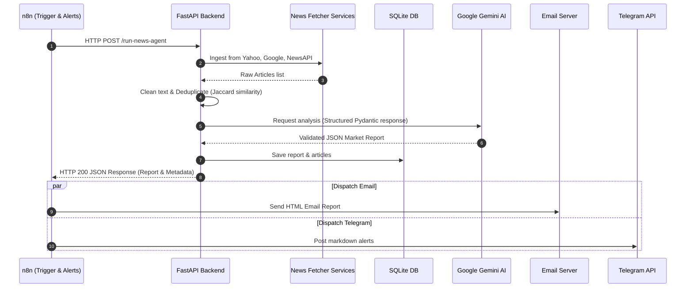

# TradeFlow AI – Decoupled Stock News Agent

TradeFlow AI is a production-ready, clean architecture AI stock news analysis and aggregation service. It automatically fetches financial headlines from Google News RSS, Yahoo Finance RSS, and NewsAPI.org, tokenizes and cleans text, applies Jaccard Similarity index deduplication, processes news batches asynchronously, extracts company profiles using Google Gemini AI, and exposes standard REST API endpoints.

Decoupled orchestration is managed via **n8n**, which executes triggers, calls the FastAPI backend, and delivers formatted notifications via **Email** and **Telegram**.

---

## Decoupled Architecture Design



---

## Project Structure
```text
tradeflow-ai/
├── backend/
│   ├── app/
│   │   ├── main.py            # FastAPI Application & lifespan manager
│   │   ├── config/
│   │   │   └── settings.py    # Pydantic Settings env validator
│   │   ├── api/
│   │   │   └── endpoints.py   # REST API endpoint handlers (GET /health, POST /run-news-agent)
│   │   ├── services/
│   │   │   ├── pipeline.py    # Orchestration service layer
│   │   │   └── cleaner.py     # Regex HTML and whitespace cleaners
│   │   ├── news/
│   │   │   ├── collector.py   # Abstract base async collector
│   │   │   ├── newsapi.py     # NewsAPI.org async collector
│   │   │   ├── google_rss.py  # Google News RSS async XML parser
│   │   │   ├── yahoo.py       # Yahoo Finance RSS async XML parser
│   │   │   └── deduplicator.py# Token-based Jaccard similarity filter
│   │   ├── ai/
│   │   │   └── client.py      # Google Gemini async client with tenacity retries
│   │   ├── prompts/
│   │   │   └── templates.py   # Financial analysis system prompts & templates
│   │   ├── models/
│   │   │   ├── db.py          # SQLAlchemy 2.0 async database models
│   │   │   └── schemas.py     # Pydantic schema validator response models
│   │   └── tests/             # Async pytest verification suites
│   ├── requirements.txt       # Dependencies list
│   └── .env.example           # Backend environment template
├── n8n/
│   └── workflow.json          # Decoupled n8n workflow configuration
└── README.md
```

---

## REST Endpoints

1. **`GET /`**: Verify backend connection.
2. **`GET /health`**: Healthcheck endpoint checking active SQLite database connections.
3. **`POST /run-news-agent`**: Triggers full ingestion cycle. Saves records, and returns structured analysis JSON.
4. **`GET /reports`**: Fetches historical reports from database.

---

## Getting Started

### 1. Backend Installation
Navigate to the `backend/` directory:
```bash
cd backend
python -m venv venv
.\venv\Scripts\activate      # Windows
source venv/bin/activate     # macOS/Linux

pip install -r requirements.txt
```

### 2. Configure Environment variables
Copy the template `.env.example` file to `.env`:
```bash
cp .env.example .env
```
Fill in your Google Gemini API Key and NewsAPI.org keys.

### 3. Run Backend Server
Start the async FastAPI server:
```bash
python app/main.py
```
Uvicorn will launch the server locally at `http://localhost:8000`. You can view the automated interactive API documentation at `http://localhost:8000/docs`.

### 4. Running Backend Tests
Execute the async verification test suite containing 10 assertions:
```bash
python -m pytest
```

---

## n8n Automation Setup

1. Launch your n8n instance (e.g. `npx n8n` or Docker).
2. Go to **Workflows > Import from File** and upload [n8n/workflow.json](file:///e:/AI%20NEWS%20AGENT/n8n/workflow.json).
3. Update the URL in **Trigger FastAPI Backend** HTTP node if hosting backend in docker (e.g. `http://host.docker.internal:8000/run-news-agent`).
4. Set up your Telegram Bot Credentials and target `TELEGRAM_CHAT_ID` environment variables.
5. Setup your Gmail/SMTP credentials for the Email Dispatcher node.
6. Toggle the workflow **Active** to schedule daily 8:00 AM executions.

---

## 24/7 Cloud VPS Deployment (Docker Compose)

To host TradeFlow AI 24/7 in the cloud so it runs even when your computer is shut down:

### 1. Requirements
- A VPS (Virtual Private Server) running Ubuntu 22.04+ (DigitalOcean, Hetzner, AWS, etc.)
- A domain name (with DNS `A` records pointed to your VPS IP address)
  - `api.yourdomain.com` (for FastAPI)
  - `n8n.yourdomain.com` (for n8n web portal)

### 2. Install Docker on your VPS
Log into your VPS and install Docker + Compose:
```bash
sudo apt update
sudo apt install -y docker.io docker-compose-v2
```

### 3. Deploy
Clone your project repository on the VPS, navigate to the root directory, and set up your domains:
```bash
export API_DOMAIN="api.yourdomain.com"
export N8N_DOMAIN="n8n.yourdomain.com"
export N8N_ENCRYPTION_KEY="a-secure-random-encryption-key"

# Start all container services (FastAPI, n8n, Caddy Proxy)
docker compose up -d --build
```

Caddy will automatically request and install free Let's Encrypt SSL certificates for both domains. Your API will be securely live at `https://api.yourdomain.com` and n8n will be live at `https://n8n.yourdomain.com`.

